<div align="center">

<picture>
  <source media="(prefers-color-scheme: dark)" srcset="assets/logo/banner_dark.svg">
  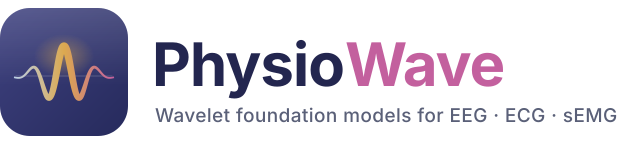
</picture>

# PhysioWave-T: Token-Efficient Wavelet Foundation Models for Biosignals

[](#citation)
[](https://arxiv.org/abs/2506.10351)
[](https://arxiv.org/abs/2506.10351)
[](https://huggingface.co/collections/ForeverBlue/physiowave-t)
[](https://pytorch.org/)
[](LICENSE)

**Pretrained EEG, ECG and sEMG encoders that take any channel count and sampling rate,
and a reliability-aware fusion model that combines them.**

</div>

PhysioWave-T extends [PhysioWave (NeurIPS 2025)](docs/physiowave_v1.md) from ECG and
sEMG to EEG, and from one fixed input layout per encoder to many. The extension
rests on three ideas:

- **Dynamic scale folding.** The wavelet subbands are recombined *before* tokenization. The sequence shrinks from $(J{+}1)CS$ to $CS$ tokens for $J$ levels, $C$ channels and $S$ patches.
- **Routes.** Each acquisition setup, defined by its channel count and sampling rate, gets its own wavelet front end. One Transformer and one channel-name vocabulary are shared by every route of a modality.
- **RALF.** Reliability-aware latent fusion combines the independently pretrained encoders with a per-sample reliability for each modality.

<div align="center">
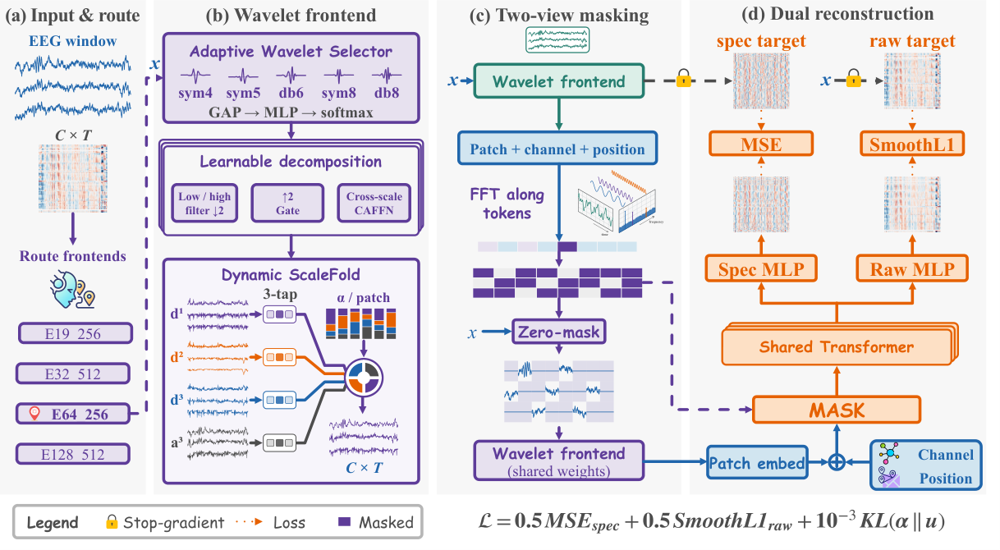
<br><sub>Overview, shown for EEG: route front ends, learnable wavelet analysis with dynamic ScaleFold, two-view masking and dual reconstruction.</sub>
</div>

## Highlights

- **One EEG foundation model across montages.** A 30 M-parameter encoder pretrained on over 15 M four-second windows from 19 to 128 channels at 256 and 512 Hz, with no common montage forced on the data.
- **4.0–7.2× faster, 6.8–12.7× less memory.** Folding cuts Transformer latency and peak memory by these factors over scale expansion, with no loss of accuracy. On 128-channel EEG, per-batch memory drops from about 32 GB to 2.5 GB.
- **State of the art on EEG, ECG and sEMG.** The EEG encoder leads eight of nine metrics against BENDR, BIOT, LaBraM and EEGPT. The ECG encoder has the highest macro-F1 on PTB-XL Super and Chapman–Shaoxing. The sEMG encoder sets new accuracies on EPN-612 and GRABMyo.
- **Wearable seizure detection.** On two behind-the-ear EEG channels the encoder reaches 61.4 % sensitivity at ≤ 11 false alarms per hour, ahead of LUNA-L with 25.4 M against 40.4 M parameters. Adding ECG and EMG raises this to 74.4 % with RALF and 78.9 % with weighted-logit fusion. RALF lifts window-level AUPRC from 0.321 to 0.399.
- **Representations that recover physiology.** Channel embeddings learned from electrode *names* recover scalp topography, and the slowest wavelet scale gains weight from wakefulness to deep sleep in 13 of 13 subjects.

## Pretrained models

All weights are on the Hugging Face Hub, gathered in the [PhysioWave-T collection](https://huggingface.co/collections/ForeverBlue/physiowave-t). Each model card lists the files, the validation metrics and a loading example.

| Model | Repository | Parameters | Routes (channels × rate) | Pretraining data |
|---|---|---|---|---|
| EEG encoder | [ForeverBlue/EEG](https://huggingface.co/ForeverBlue/EEG) | 30.3 M | 19 × 256, 32 × 512, 64 × 256, 128 × 512 | 7 corpora, 15.4 M windows of 4 s |
| ECG encoder | [ForeverBlue/ECG](https://huggingface.co/ForeverBlue/ECG) | 30.1 M | 12 × 500, 1 × 250 | 7 corpora, 7.6 M windows of 10 s |
| sEMG encoder | [ForeverBlue/EMG](https://huggingface.co/ForeverBlue/EMG) | 12.1 M | 16 × 2000, 24 × 2000, 64 × 2000 | 6 corpora, 5.1 M windows of 1 s |
| RALF seizure detector | [ForeverBlue/RALF-SeizeIT2](https://huggingface.co/ForeverBlue/RALF-SeizeIT2) | three encoders + fusion | bte-EEG + ECG + EMG, 4 s | SeizeIT2, official split |

Every encoder repository has two kinds of file:

- **`<modality>_c1_encoder.pth`** holds the channel embedding and the shared Transformer. It loads onto any montage, and is the file to fine-tune from.
- **`pretrain_<modality>_c1_moe_*.pth`** is the complete pretraining model: every route front end and both decoders. Use it to continue pretraining, or to fine-tune on a montage that *is* one of the routes.

## Method

<table>
<tr>
<td width="58%">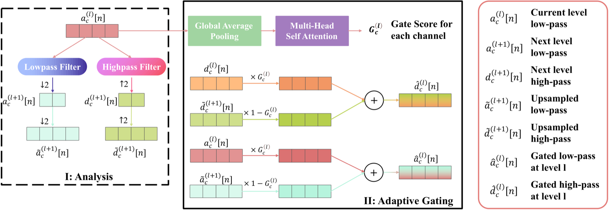</td>
<td width="42%">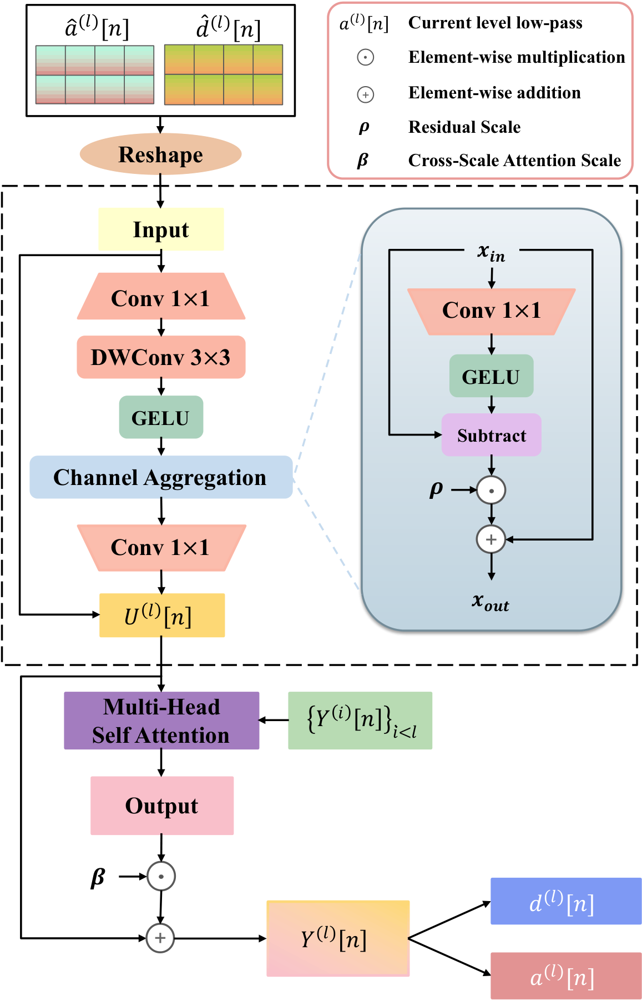</td>
</tr>
<tr>
<td><sub><b>Soft-gated wavelet analysis.</b> Five learnable wavelet filter pairs per channel are mixed by a selector. Channel-specific gates blend the upsampled subbands with the running approximation and detail states.</sub></td>
<td><sub><b>Cross-scale channel-aggregation FFN (CAFFN).</b> The current approximation–detail pair is refined by convolution and channel aggregation.</sub></td>
</tr>
</table>

**Dynamic ScaleFold.** Per channel and per patch, a small network predicts weights over the $J{+}1$ subbands from their local statistics. The subbands are then summed into one row, refined by a 3-tap synthesis filter. The Transformer therefore sees $C \times S$ tokens however deep the decomposition is. Folding has no channel-specific parameters, so it transfers unchanged to new montages.

**Pretraining.** The masked windows go through the front end, and the Transformer reconstructs them through two heads: the folded wavelet patch (MSE) and the preprocessed waveform (SmoothL1). Masking is frequency-guided at a 70 % ratio and applied *before* the front end.

**Adaptation to unseen setups.** A downstream montage that matches no route gets a fresh front end, seeded from the same wavelet families. The pretrained Transformer and channel embedding are reused, and new sensor names get new embedding rows.

<div align="center">
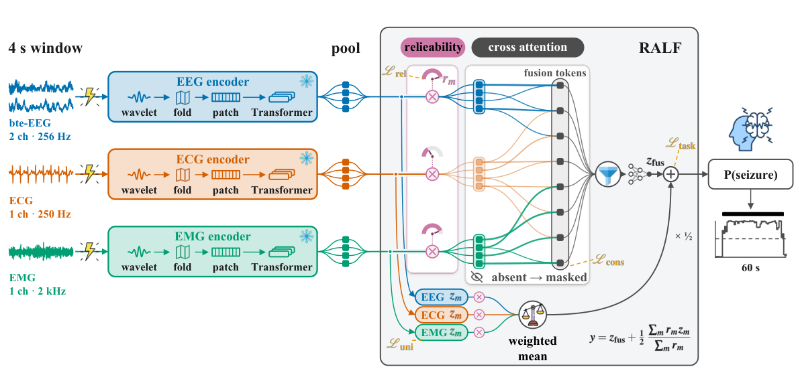
<br><sub><b>Reliability-aware latent fusion (RALF).</b> Each encoder contributes four summary tokens. A per-sample reliability gates each modality's tokens in the cross-attention and weights its unimodal prediction. Missing modalities are masked out.</sub>
</div>

## Results

### EEG

Balanced accuracy (BAC), Cohen's kappa, weighted F1 and AUROC. Our values are means over three seeds.

| Method | Params | Sleep-EDFx BAC | Kappa | W-F1 | P300 BAC | Kappa | AUROC | KaggleERN BAC | Kappa | AUROC |
|---|---|---|---|---|---|---|---|---|---|---|
| BENDR | 157M | 0.6655 | 0.6659 | 0.7507 | 0.6114 | 0.2227 | 0.6588 | 0.5672 | 0.1461 | 0.6030 |
| BIOT | 3.2M | 0.6622 | 0.6461 | 0.7415 | 0.5485 | 0.0968 | 0.5308 | 0.5118 | 0.0297 | 0.5495 |
| LaBraM | 5.8M | 0.6771 | 0.6710 | 0.7592 | 0.6477 | 0.2935 | 0.7068 | 0.5439 | 0.0944 | 0.5693 |
| EEGPT | 25M | 0.6917 | 0.6857 | 0.7654 | 0.6502 | **0.2999** | 0.7168 | 0.5837 | 0.1882 | 0.6621 |
| **PhysioWave-T (fine-tune)** | 30M | **0.7060** | **0.7365** | **0.8092** | **0.6706** | 0.2975 | **0.7370** | **0.6171** | **0.2059** | **0.6632** |

Sleep-EDFx's 100 Hz derivations are not among the pretraining routes, so the encoder runs on a new front end.

### ECG

Macro-F1 and macro-AUROC in %.

| Method | Params | PTB-XL Super F1 | AUC | CPSC 2018 F1 | AUC | Chapman F1 | AUC |
|---|---|---|---|---|---|---|---|
| MERL | 11M | 48.1 | 91.9 | 72.8 | 92.6 | — | 87.9 |
| OpenECG-MAE | 11M | 48.1 | 90.9 | **74.5** | 93.2 | 50.8 | 94.2 |
| PhysioWave-L | 37M | 66.7 | **94.6** | 73.1 | **96.1** | 54.8 | 98.3 |
| **PhysioWave-T (fine-tune)** | 30M | **70.9** | 90.3 | 73.1 | 94.2 | **56.7** | **99.4** |

### sEMG

Gesture recognition accuracy and macro-F1 in %.

| Method | Params | EPN-612 Acc. | F1 | GRABMyo Acc. | F1 |
|---|---|---|---|---|---|
| MOMENT | 385M | 90.87 | 90.16 | 82.67 | 82.19 |
| OTiS | 45M | 87.55 | 88.03 | 79.38 | 78.80 |
| PhysioWave-L | 37M | 94.50 | 94.56 | 88.53 | 88.37 |
| **PhysioWave-T (fine-tune)** | 12M | **94.80** | **94.79** | **89.78** | **89.74** |

The paper's tables also list the from-scratch and linear-probe rows and every baseline.

### Multimodal seizure detection (SeizeIT2)

<div align="center">
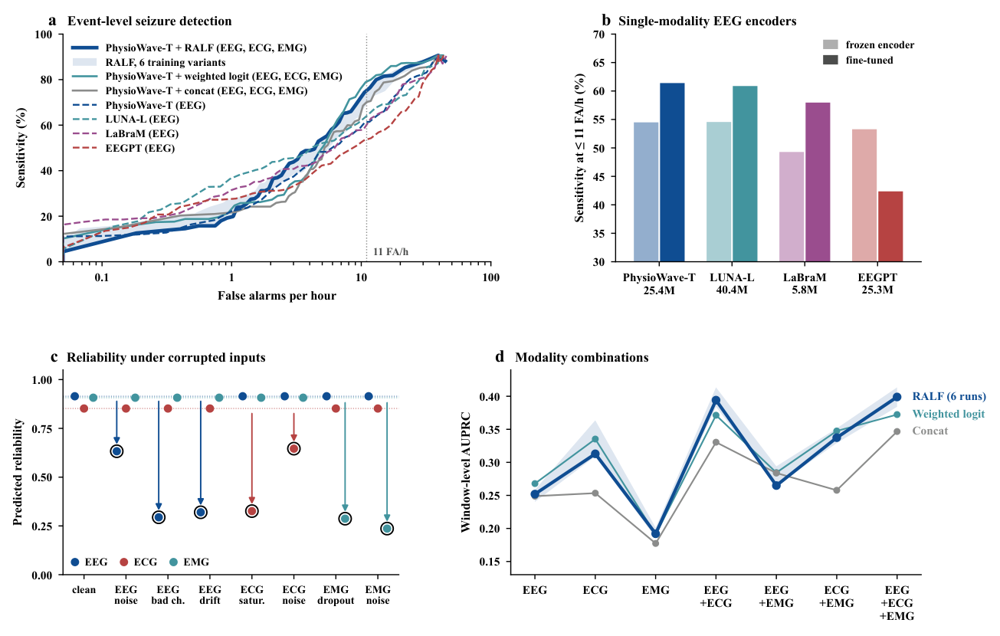
</div>

The panels show the official split: 29 test patients, 2,912 h and 181 seizures.

- **(a) Event-level detection.** Fusing EEG, ECG and EMG beats every EEG-only foundation model at the clinical operating points: at 11 false alarms per hour sensitivity rises from 61.4 % to 74.4 % with RALF and 78.9 % with weighted-logit fusion.
- **(b) EEG-only encoders.** Fine-tuned, PhysioWave-T is the most sensitive of the four EEG encoders, with 25.4 M parameters against LUNA-L's 40.4 M.
- **(c) Reliability.** Corrupting one modality lowers only that modality's reliability.
- **(d) Fusion rules.** All six RALF training variants exceed weighted-logit and concatenation fusion in AUPRC whenever EEG and ECG are present together.

### Efficiency

<div align="center">
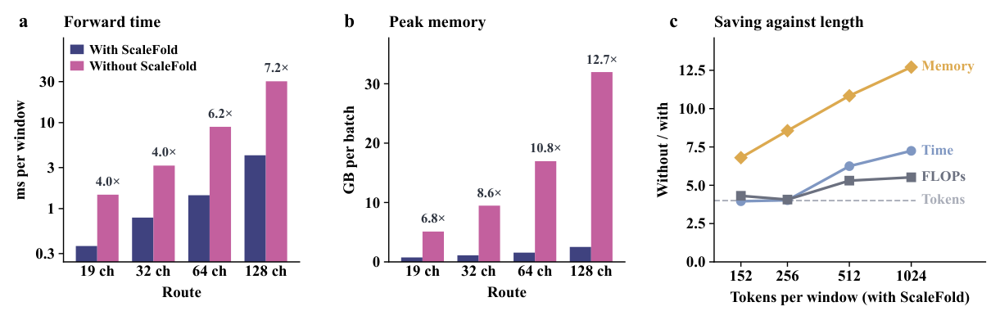
</div>

These are EEG encoder measurements on a single GPU in bf16, at the training batch sizes. Folding cuts latency by 4.0–7.2× and peak memory by 6.8–12.7×, while the dynamic fold itself costs 1.5–2.6 % of the forward pass. The saving grows with channel count.

## What the encoders learned

<div align="center">
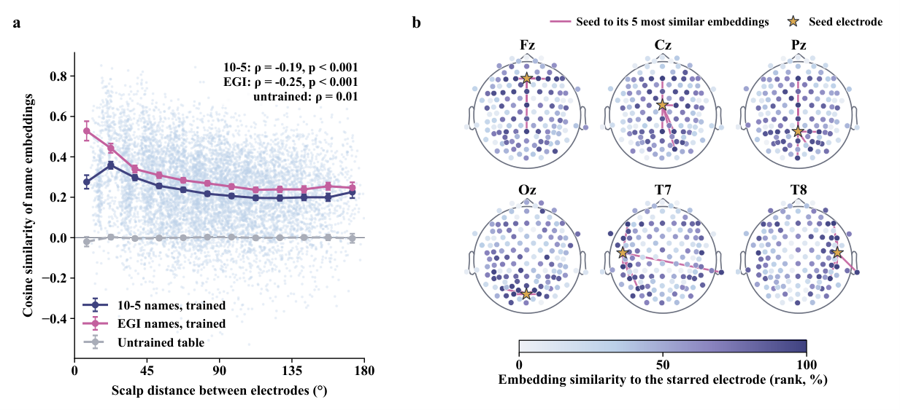
</div>

**Scalp topology from names alone.** Embedding similarity falls with geodesic scalp distance, both in the 10-5 system and on the 128-electrode EGI net (Spearman ρ = −0.19 and −0.25, p < 0.001). An electrode's five nearest neighbours in embedding space lie 44–56° apart on the scalp, against 84–88° when shuffled. The model never saw coordinates.

<div align="center">
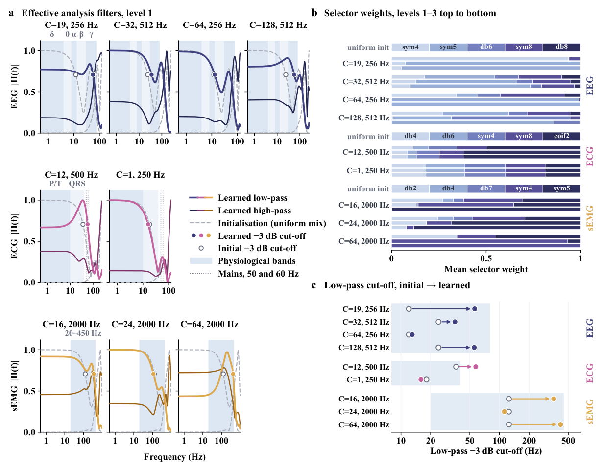
</div>

**Spectral adaptation per modality.** Pretraining moves each front end's pass-band onto its modality's informative range. On 19-channel EEG the low-pass widens from 12 Hz to 56 Hz, covering the γ band. On high-density sEMG it rises from 125 Hz to 356–418 Hz, the upper edge of the EMG band. On most routes, the deeper decomposition levels specialise to a single wavelet.

<div align="center">
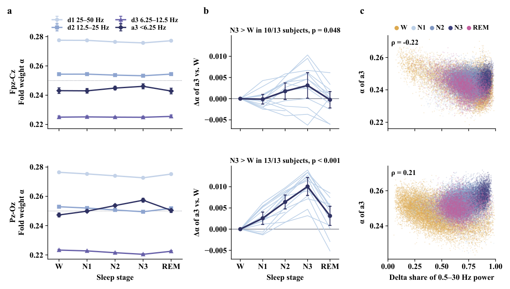
</div>

**Scale allocation follows sleep.** After fine-tuning for staging, ScaleFold gives more weight to the slowest scale from wakefulness to N3. On Pz-Oz this holds in 13 of 13 test subjects (Wilcoxon p = 2.4 × 10⁻⁴). The fold was never shown a stage label.

<details>
<summary><b>Masked reconstruction examples</b></summary>

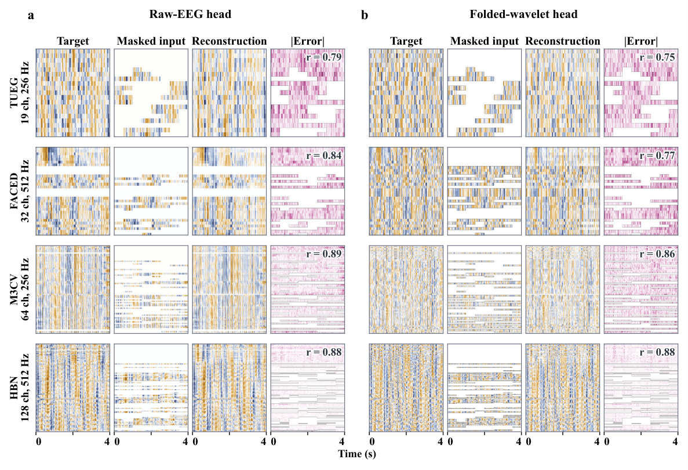
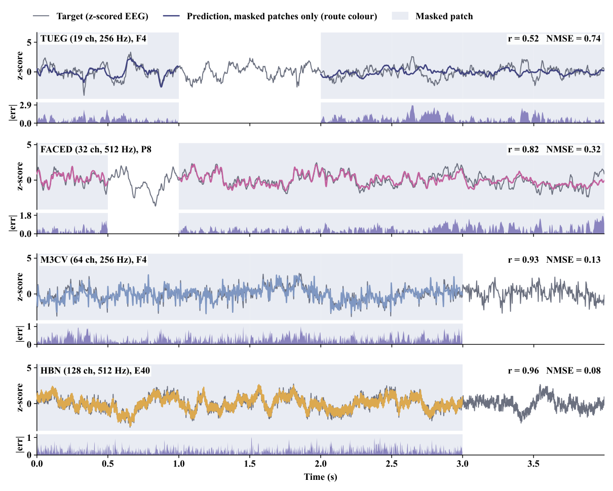

The examples come from four EEG routes spanning 19–128 channels, with 70 % of patches masked. Each route shows its median-NMSE validation window, not its best.
</details>

## Installation

```bash
git clone https://github.com/ForeverBlue816/PhysioWave.git
cd PhysioWave
conda create -n physiowave python=3.11 -y && conda activate physiowave
pip install torch --index-url https://download.pytorch.org/whl/cu121   # PyTorch >= 2.2
pip install -r requirements.txt
pip install huggingface_hub          # to download the weights
```

## Quick start: fine-tune a pretrained encoder

The encoder file loads onto any montage. Your montage supplies the front end and the patch embedding, and the checkpoint supplies the rest.

```python
import torch
from huggingface_hub import hf_hub_download
from physiowave.eeg_c1.downstream import EEGC1Downstream

ENC = hf_hub_download("ForeverBlue/EEG", "eeg_c1_encoder.pth")
ck = torch.load(ENC, map_location="cpu", weights_only=False)
mc = ck["model_config"]
CH = ["Fz", "Cz", "Pz", "Oz", "C3", "C4", "P3", "P4"]          # your electrodes, by name

model = EEGC1Downstream(
    in_channels=len(CH), window_samples=1024, sampling_rate=256.0,
    patch_samples=128, num_classes=2, channel_names=CH,
    embed_dim=mc["embed_dim"], depth=mc["depth"], num_heads=mc["num_heads"],
    channel_embed_dim=mc.get("channel_embed_dim", 64),
    channel_vocab_size=ck["channel_vocab_size"])
print(model.describe_transfer(model.load_pretrained(ENC)))
# loaded: transformer N, channel encoder N, gate yes, frontend 0, patcher 0

class Meta:
    channel_names = CH
    channel_mask = None

logits = model(torch.randn(2, len(CH), 1024), Meta())["logits"]     # [2, 2]
```

For ECG and sEMG, swap in `physiowave.ecg_c1.downstream.ECGC1Downstream` with `ForeverBlue/ECG`, or `physiowave.emg_c1.downstream.EMGC1Downstream` with `ForeverBlue/EMG`. Pass real channel names, because the checkpoint's vocabulary hash is checked on load.

## Reproducing the paper

All runs were trained on the CINECA Leonardo cluster; [docs/cineca_setup.md](docs/cineca_setup.md) has the environment and Slurm jobs.

```bash
# Pretraining, one modality each. Corpora and preprocessing: see the script headers
bash EEG/pretrain_eeg_c1_moe.sh
bash ECG/pretrain_ecg_c1_moe.sh
bash EMG/pretrain_emg_c1_moe.sh

# Downstream: MODE = ft | probe | scratch
TASK=sleep_edf   MODE=ft bash EEG/finetune_eeg_c1.sh
TASK=ptbxl       MODE=ft bash ECG/finetune_ecg_c1.sh
TASK=epn612      MODE=ft bash EMG/finetune_emg_c1.sh

# Multimodal fusion on SeizeIT2: prepare windows, train, then event-level scoring
python Fusion/seizeit2_prep.py --help
python -m physiowave.fusion.train --config fusion/c1_ralf --output-dir runs/ralf \
    --set encoders.eeg=<EEG ckpt> encoders.ecg=<ECG ckpt> encoders.emg=<EMG ckpt>
python Fusion/seizeit2_events.py --help
```

| Topic | Document |
|---|---|
| Architecture, routes, corpora, training budgets | [docs/c1_pretraining_architecture.md](docs/c1_pretraining_architecture.md) |
| EEG downstream: Sleep-EDFx, P300, KaggleERN | [docs/eeg_downstream.md](docs/eeg_downstream.md), [docs/eegpt_benchmarks.md](docs/eegpt_benchmarks.md) |
| ECG downstream | [docs/ecg_downstream.md](docs/ecg_downstream.md) |
| sEMG downstream | [docs/emg_downstream.md](docs/emg_downstream.md) |
| Multimodal fusion and the SeizeIT2 evaluation | [docs/fusion.md](docs/fusion.md) |
| Per-run metrics and figures | [docs/runs/](docs/runs/) |
| Releasing weights to the Hub | `scripts/prepare_hf_release.py`, `scripts/prepare_hf_fusion_release.py` |

## Repository layout

```
physiowave/
  eeg_c1/  ecg_c1/  emg_c1/   PhysioWave-T encoders: routes, model, pretraining, downstream
  fusion/                     RALF and the baselines, SeizeIT2 / MPDB data, event scoring
  wavelet/  train/  pretrain/ shared wavelet modules, training loops, corruption
EEG/  ECG/  EMG/  Fusion/     entry scripts and dataset preparation
configs/                      pretraining, fine-tuning and fusion configs
scripts/                      figures, benchmarks, Slurm jobs, Hub releases
docs/                         methods, protocols, run records
model.py  pretrain.py  finetune.py   the original PhysioWave (NeurIPS 2025), unchanged
```

## PhysioWave (NeurIPS 2025)

The original ECG and sEMG model, with its training and fine-tuning guide, is still in this repository: [docs/physiowave_v1.md](docs/physiowave_v1.md).

## Citation

```bibtex
@article{chen2026physiowavet,
  title   = {PhysioWave-T: Token-Efficient Wavelet Foundation Models for Biosignals},
  author  = {Chen, Yanlong and Benatti, Simone and Benini, Luca and Guan, Cuntai and Li, Yawei},
  journal = {IEEE Transactions on Pattern Analysis and Machine Intelligence},
  note    = {Under review},
  year    = {2026}
}

@inproceedings{chen2025physiowave,
  title     = {PhysioWave: A Multi-Scale Wavelet-Transformer for Physiological Signal Representation},
  author    = {Chen, Yanlong and Orlandi, Mattia and Rapa, Pierangelo Maria and Benatti, Simone and Benini, Luca and Li, Yawei},
  booktitle = {Advances in Neural Information Processing Systems (NeurIPS)},
  year      = {2025}
}
```

## License and contact

The code is released under the [MIT License](LICENSE). The pretraining corpora keep their own licenses and data-use agreements. Questions and issues: [GitHub issues](https://github.com/ForeverBlue816/PhysioWave/issues) or yanlong.chen@ntu.edu.sg.
